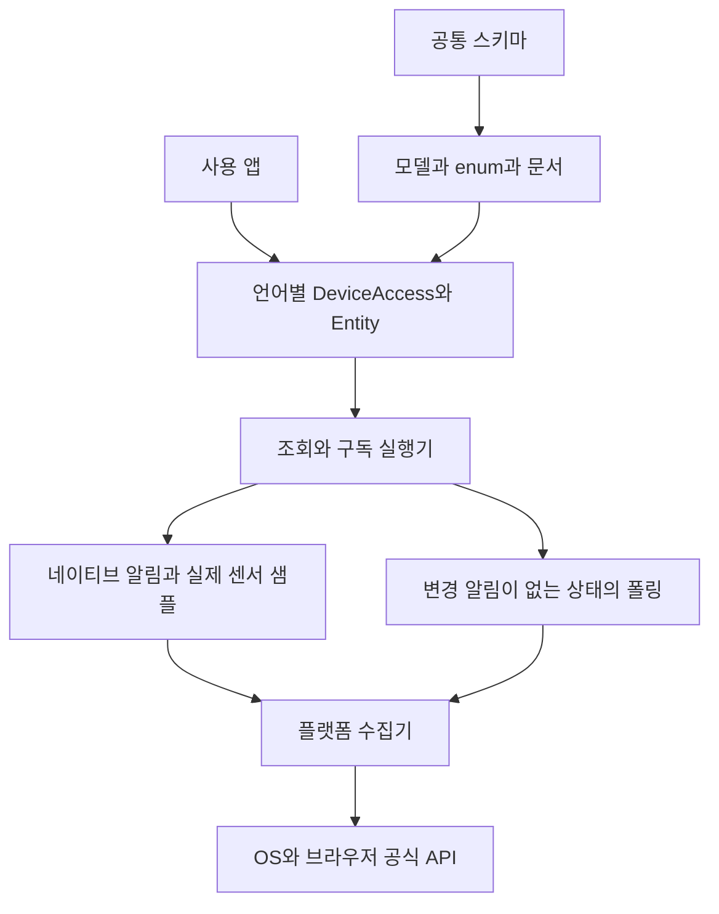

# 설계 범위와 원칙

**DeviceReadout**은 실행 중인 기기와 그 기기에 연결된 자원의 정보를 읽는 공개 오픈소스 SDK다. 공통 접근 인터페이스는 **DeviceAccess**이며, 타입이 있는 Entity를 전달하는 `get(Entity)`와 `watch(Entity)`를 중심으로 구성한다.

설계 기준일은 **2026년 11월 7일**이다. 이 명세는 확정된 제품·API 계약과 구현 목표를 정리한다. 지원 환경의 실제 호환성은 구현 후 해당 환경에서 검증한다.

| 항목 | 계약 |
|---|---|
| 라이선스 | MIT |
| 실행 대상 | Android, iOS, Windows, macOS, 웹 |
| 언어와 프레임워크 | Kotlin, Swift, C#, JavaScript/TypeScript, Flutter, React Native |
| 배포 방식 | 언어·프레임워크별 패키지가 동일한 개념과 데이터 의미를 제공 |
| 첫 버전 범위 | 기본 기기 정보, 식별자, CPU·RAM, 화면, 전원·배터리, 네트워크, 저장소, 센서 |
| 구성 방식 | 필요한 기능 모듈을 선택해 사용 |
| 데이터 처리 | SDK는 값을 제공하고, 활용·판단·기기 매칭은 사용하는 앱이 결정 |
| 수집 시작 | import나 객체 준비만으로 수집하지 않음. 명시적 조회 또는 스트림 구독으로 시작 |
| 외부 전송 | SDK 서버, 자동 업로드, 텔레메트리 없음 |
| 권한 | 자동 요청 없음. 개발자가 명시적으로 확인·요청 |
| 조회 대상 | 현재 실행 환경의 기기·자원. 식별자를 넣어 원격 기기를 찾는 기능은 없음 |

언어와 플랫폼이 달라도 같은 계약을 사용하되, 실제 패키지와 비동기 스트림 타입은 해당 생태계에 맞춘다. 모든 언어에서 하나의 바이너리를 그대로 import하는 방식은 아니다.

플랫폼이 제공하는 값과 파생 가능한 값은 포함한다. 값마다 정확도·추정 여부를 표시하는 메타데이터나 접두어는 추가하지 않는다. 다만 시스템 RAM과 앱 메모리 한도, 물리 디스크와 웹 origin 저장 한도처럼 의미가 다른 값은 별도 필드·엔티티로 구분한다.

## 실행 경로와 앱 옵저버

2026년 11월 11일 실행 계약 보완: 화면·권한·앱 생명주기처럼 앱 실행 경로의 처리가 필요한 상태는 앱이 등록한 옵저버가 SDK에 전달한다. `get`·`watch`·`list`는 화면 API를 직접 조회하거나 권한 창을 열지 않는다. 명시적인 권한 요청은 앱의 권한 처리 연결부에 전달하고, 실제 권한 상태는 옵저버 입력으로 갱신한다.

무거운 네이티브 수집·폴링·정규화·정리는 별도 워커에서 수행한다. 플랫폼이 앱 실행 경로를 요구하는 콜백에서는 필요한 상태 전달만 수행하며, 조회 타임아웃·취소·해제가 느린 네이티브 작업의 완료를 기다리며 UI를 막지 않도록 한다. 워커 사용은 프로세스 분리나 모든 네이티브 장애로부터의 격리를 뜻하지 않는다. 언어별 구현과 검증 범위는 [실행 계약](execution-isolation.md)과 [구현 현황](implementation-status.md)에 기록한다.

# 공통 데이터 계약

## Entity와 Snapshot

`Entity<S>`는 조회 대상과 반환할 Snapshot 타입을 나타낸다. Entity에는 `get()`·`watch()` 실행 메서드를 두지 않는다. 실행은 `DeviceAccess`가 담당한다.

시스템 RAM처럼 대상이 하나인 자원은 `RamEntity` 같은 단일 Entity를 사용한다. 화면·저장 볼륨·네트워크 인터페이스·CPU 코어·센서처럼 여러 개일 수 있는 자원은 목록에서 얻은 타입 핸들을 사용한다. 핸들은 SDK 실행 컨텍스트 안에서 대상을 식별하며 영구적인 물리 기기 ID를 의미하지 않는다.

Snapshot은 불변 값이다. 모든 Snapshot에는 null이 아닌 `collectedAt: Instant`가 하나 있으며, 조회 데이터 필드는 nullable이다. 아래 필드 표의 `?`는 이를 나타낸다.

## 값과 null

| 상황 | 반환 |
|---|---|
| 정상 조회 | 값을 직접 반환 |
| 값이 실제로 0 또는 false | 0 또는 false 유지 |
| 조회에 성공했고 목록이 비어 있음 | 빈 목록 또는 빈 집합 |
| 개별 필드 미지원·권한 부족·일시적 읽기 불가 | 해당 필드 null |
| SDK가 모르는 enum 값 | 해당 필드 null |
| enum 목록에 미인식 원소가 하나 이상 있음 | 해당 목록 필드 전체 null |
| 대상 전체 미지원·제거·조회 전체 실패 | 타입으로 구분되는 오류 |

`FieldResult<T>`, 필드별 상태·수집 시각, `EntityEvent<T>`, `changedFields`를 사용하지 않는다. Snapshot만 읽으면 해당 조회에서 얻은 전체 상태를 알 수 있다. null 자체는 실패 원인을 구분하지 않으며, 지원 여부와 권한은 별도 API로 확인한다.

예를 들어 네트워크 transport에 알려진 Wifi와 미인식 값이 섞여 있으면 `transports = null`이다. 알려진 원소만 남겨 완전한 목록처럼 반환하지 않는다.

## 시각과 단위

`collectedAt`은 SDK 수집기가 해당 Snapshot의 조회·조립을 완료한 UTC 시각이다. 모든 필드를 같은 순간에 측정했다는 뜻은 아니며, 센서 하드웨어의 원본 측정 시각도 아니다. 이벤트에 유지된 값이 포함되어도 별도 필드 시각은 추가하지 않는다.

| 타입·단위 | 표현 |
|---|---|
| Instant | 언어별 시각 타입. JSON은 UTC ISO 8601 |
| Duration | 언어별 타입이 있는 시간 길이. 단위 없는 숫자 옵션을 사용하지 않음 |
| ByteCount | 64비트 정수 의미. 별도 결과 포장 객체가 아님 |
| 큰 누적 카운터 | 64비트 정수 의미 유지 |
| JavaScript의 큰 정수 | bigint |
| JSON의 큰 정수 | 10진수 문자열 |
| 비율 | 0.0–1.0. 배터리 잔량·밝기·상대 습도 등에 적용 |
| 주파수·전송 속도 | Hz, bit/s |
| 거리·온도·압력 | m, °C, Pa. 다른 단위는 필드명에 명시 |
| 구조화된 값 | Size, Rect, Insets, Vector3, Quaternion 등 타입 사용 |
| 상태·종류 | 생성된 enum 또는 타입이 있는 합집합 사용 |
| 표준 식별 문자열 | 언어 태그·시간대 ID·파일 시스템 이름 등 원래 문자열인 데이터는 문자열로 유지 |

기본 구조체의 성분은 다음과 같다. 이는 별도 수집 결과 포장이 아니라 한 값을 구성하는 데이터다.

| 구조체 | 성분 |
|---|---|
| Size | width, height |
| Rect | x, y, width, height |
| Insets | top, right, bottom, left |
| Vector3 | x, y, z |
| Quaternion | x, y, z, w |
| DisplayMode | pixelSize, refreshRateHz |

문자열로 Entity나 필드 키를 전달하지 않는다. 단위·종류·오류 처리를 위한 magic string을 공개 API에 요구하지 않는다.

## RAM 반환 예시

다음 Kotlin은 공개 계약을 설명하는 예시이며 완성된 패키지 구현 코드는 아니다.

```kotlin
data class RamSnapshot(
    override val collectedAt: Instant,
    val physicalBytes: ByteCount?,
    val kernelAccessibleBytes: ByteCount?,
    val advertisedBytes: ByteCount?,
    val availableBytes: ByteCount?,
    val freeBytes: ByteCount?,
    val lowMemory: Boolean?,
    val lowMemoryThresholdBytes: ByteCount?,
) : DeviceSnapshot
```

다음 값은 형식을 보여 주는 예시이며 실제 사용자 기기를 조회한 결과가 아니다.

```json
{
  "collectedAt": "2026-11-07T01:00:00Z",
  "physicalBytes": "17179869184",
  "kernelAccessibleBytes": null,
  "advertisedBytes": null,
  "availableBytes": "5368709120",
  "freeBytes": "2147483648",
  "lowMemory": false,
  "lowMemoryThresholdBytes": "1073741824"
}
```

# 공개 API

## 중심 인터페이스

```kotlin
interface DeviceSnapshot {
    val collectedAt: Instant
}

interface Entity<out S : DeviceSnapshot>

interface DeviceAccess {
    val pollInterval: Duration
    val readTimeout: Duration
    val sensorSamplingRate: SensorSamplingRate

    suspend fun <S : DeviceSnapshot> get(entity: Entity<S>): S

    fun <S : DeviceSnapshot> watch(entity: Entity<S>): Flow<S>
}
```

`get(RamEntity)`는 `RamSnapshot`, `watch(RamEntity)`는 `Flow<RamSnapshot>`으로 타입을 추론한다. `Any` 반환 후 캐스팅하거나 문자열 키로 대상을 고르지 않는다.

```kotlin
val ram: RamSnapshot = sdk.get(RamEntity)
val snapshots: Flow<RamSnapshot> = sdk.watch(RamEntity)

snapshots.collect { snapshot ->
    render(snapshot)
}

val display = sdk.displays.list().firstOrNull()
if (display != null) {
    val screen: DisplaySnapshot = sdk.get(display)
    sdk.watch(display).collect { snapshot ->
        render(snapshot)
    }
}
```

## 불변 설정

| 속성 | 기본값 | 설정 API | 적용 대상 |
|---|---|---|---|
| pollInterval | 1초 | withPollInterval(Duration) | 폴링이 필요한 조회 |
| readTimeout | 5초 | withReadTimeout(Duration) | get과 watch 내부의 개별 조회 |
| sensorSamplingRate | PlatformDefault | withSensorSamplingRate(rate) | 연속 센서의 watch에 대한 수집 빈도 요청 |

시간 길이와 명시적 Hz는 양수·유한값을 사용한다. 잘못된 설정은 새 설정 객체를 만드는 시점에 오류로 처리한다. `PlatformDefault`는 타입이 있는 선택지이며 0이나 문자열을 대신 사용하는 방식이 아니다.

Kotlin에서는 다음 확장 함수 형태로 제공한다. 다른 언어에서도 동일한 불변 설정 의미를 유지한다.

```kotlin
fun DeviceAccess.withPollInterval(interval: Duration): DeviceAccess
fun DeviceAccess.withReadTimeout(timeout: Duration): DeviceAccess
fun DeviceAccess.withSensorSamplingRate(
    rate: SensorSamplingRate
): DeviceAccess
```

`60.hertz`는 명시적인 빈도 요청을 구성하는 타입이 있는 편의 표현이다.

```kotlin
val normal = sdk
val fast = sdk.withPollInterval(500.milliseconds)
val slow = sdk.withPollInterval(5.seconds)

val sensors = sdk
    .withReadTimeout(10.seconds)
    .withSensorSamplingRate(60.hertz)

val platformDefaults = sensors.withSensorSamplingRate(
    SensorSamplingRate.PlatformDefault
)
```

모든 `with…()`는 새 설정 객체 또는 설정 뷰를 반환한다. 원본, 이미 만들어진 스트림, 기존 구독에는 영향이 없다. 다른 설정은 보존하므로 체이닝할 수 있다.

같은 실행 컨텍스트와 Entity 핸들을 재사용할 수 있다. 기반 수집기를 공유하더라도 서로 다른 설정 객체의 폴링 일정과 전달 간격은 독립적으로 유지한다. 설정은 실제 구현에 보관하며, 저장 상태가 없는 Kotlin 확장 프로퍼티에 설정을 저장하는 것으로 설계하지 않는다.

`pollInterval`은 네이티브 이벤트의 전달 빈도를 제한하거나 센서 수집 빈도를 변경하지 않는다.

## 탐색과 보조 API

| API | 역할 |
|---|---|
| sdk.get(entity) | 대상의 Snapshot 한 건 조회 |
| sdk.watch(entity) | 해당 Snapshot 타입의 비동기 스트림 생성 |
| sdk.displays.list() 등 자원별 list() | 타입이 있는 대상 핸들 목록 탐색 |
| 의미가 명확한 컬렉션의 current() | 현재 화면·앱 저장 볼륨 등 명확한 현재 대상 탐색 |
| sdk.describe(sensor) | 센서 메타데이터 조회 |
| sdk.capabilities.get(entity) | 해당 실행 환경에서의 지원 정보 확인 |
| sdk.permissions.check(entity) | 필요한 권한의 현재 상태 확인 |
| sdk.permissions.request(entity) | 개발자의 명시적 호출에 따라 권한 요청 |

다중 대상 탐색은 화면, CPU 코어, 저장 볼륨, 배터리, 네트워크 인터페이스, 셀룰러 구독·슬롯, 센서에 같은 원칙으로 적용한다. 현재 대상을 결정할 근거가 없으면 임의로 첫 번째 항목을 선택하지 않는다. 목록 조회 성공 후 대상이 없으면 빈 목록, 목록 조회 자체가 실패하면 오류다.

보조 API도 타입이 있는 결과를 사용한다. 네이티브 변경 알림이 없다는 이유만으로 읽을 수 있는 상태 Entity의 watch를 미지원으로 판정하지 않는다.

## 언어별 비동기 표현

| 언어·프레임워크 | get | watch |
|---|---|---|
| Kotlin | suspend 함수 | Flow<Snapshot> |
| Dart·Flutter | Future<Snapshot> | Stream<Snapshot> |
| Swift | async throws | 오류 전달이 가능한 AsyncSequence |
| JavaScript·TypeScript·React Native | Promise<Snapshot> | AsyncIterable<Snapshot> |
| C# | 비동기 작업 | IAsyncEnumerable<Snapshot> |

오류 전달과 취소 문법은 해당 언어의 관례를 따르며, 공통 의미는 동일하다.

# 조회와 구독 동작

## get

`get(entity)`는 Entity 전체의 Snapshot 한 건을 반환한다. 센서 상태·측정값의 일회 조회는 실제 샘플 하나를 기다리고, 이벤트 센서의 일회 조회는 다음 실제 발생 한 건을 기다린다. 센서 종류·제조사 등 메타데이터는 `describe(sensor)`로 분리한다.

기본 조회 제한은 5초다. 전체 조회가 제한을 초과하면 ReadTimeout 오류다. 개별 필드만 읽지 못한 경우의 null 처리와 전체 요청의 시간 초과는 구분한다.

## watch

`watch(entity)` 호출은 스트림만 만들고, 실제 구독 또는 수집이 시작될 때 수집 자원을 확보한다.

| 대상 | 최초 전달 | 이후 전달 |
|---|---|---|
| 일반 상태 Entity | 즉시 조회한 Snapshot | 네이티브 알림 또는 폴링 |
| 연속 센서 | 실제 첫 샘플을 기다려 전달 | 실제 수집 샘플 |
| 발생형 이벤트 센서 | 실제 첫 발생까지 대기 | 실제 발생마다 전달 |

일반 상태 Entity는 가능한 경우 네이티브 변경 알림을 사용한다. 변경 알림이 없으면 기본 1초 간격으로 폴링한다. 일부 필드만 변경 알림을 제공하면 필요한 부분에 폴링을 함께 사용한다.

폴링은 값이 같아도 매 조회마다 Snapshot을 전달하고 `collectedAt`을 갱신한다. 읽기가 간격보다 오래 걸려도 폴링 작업을 겹치거나 밀린 작업을 계속 쌓지 않는다. 변경 이벤트를 제공하지 않는다는 이유만으로 관찰 기능을 거절하지 않는다.

SDK는 별도 중복 제거, debounce, 최신 값만 남기기, 자동 재시도를 적용하지 않는다. 앱이 스트림 연산자로 처리한다. 플랫폼과 비동기 런타임의 전달 큐는 존재할 수 있으므로 모든 환경에서 무한 버퍼나 무손실 전달을 보장하는 계약은 아니다.

## 시간 제한과 이벤트 센서

`readTimeout`은 최초 조회와 이후 실제로 수행하는 개별 조회에 적용한다. 스트림 전체 수명, 다음 변경 이벤트를 기다리는 시간, 사용자 권한 응답을 기다리는 시간에는 적용하지 않는다.

걸음 감지·큰 움직임 감지처럼 발생을 알리는 센서의 watch는 최초 get을 수행하지 않는다. 발생이 없으면 전달 없이 구독을 유지한다. 가짜 초기 이벤트나 주기적인 발생 이벤트를 만들지 않는다. 동일 센서의 get은 다음 발생 한 건을 기다리므로 조회 제한을 적용한다.

## 종료와 수명

- 구독 취소 시 해당 구독의 자원을 해제한다. 공유 수집기의 마지막 구독이 끝나면 네이티브 관찰과 폴링도 해제한다.

- 전체 수집 실패·대상 제거는 스트림의 오류로 전달한다. 대상 제거 후 다른 장치에 자동으로 연결하지 않는다.

- 호출자 취소는 언어별 취소 관례로 전파한다.

- 모바일·웹의 센서 구독은 비활성·백그라운드·숨김 상태에서 수집을 중단하고 활성 상태로 돌아오면 유지 중인 구독의 수집을 재개한다.

- 데스크톱 창이 단순히 포커스를 잃었다는 이유만으로 센서 수집을 중단하지 않는다.

운영체제의 백그라운드 실행 제한이나 브라우저 타이머 제한을 우회해 정확한 간격을 보장하지 않는다.

# 엔티티별 필드

각 표에는 공통 필드 `collectedAt: Instant`를 생략했다. 모든 조회 필드는 nullable이다. Entity 이름에서 Entity를 Snapshot으로 바꾼 반환 모델을 사용하며, 아래 표의 타입명은 언어별 바인딩에서 같은 의미로 생성한다.

특정 플랫폼 전용 Entity는 해당 플랫폼에서만 동작한다. Entity 전체가 없으면 오류, 해당 Entity의 일부 필드만 없으면 null이라는 공통 규칙을 따른다. 목록에 포함된 필드가 모든 플랫폼에서 제공된다는 의미는 아니다.

## 기본 기기와 운영체제

### DeviceInfoEntity

대상: 실행 기기. 반환: `DeviceInfoSnapshot`.

| 필드 | 타입 | 의미 |
|---|---|---|
| `manufacturer` | `String?` | 제조사 |
| `brand` | `String?` | 브랜드 |
| `modelCode` | `String?` | 플랫폼의 모델 코드 |
| `modelName` | `String?` | 사용자에게 표시할 모델 이름 |
| `deviceName` | `String?` | OS가 공개하는 기기 이름 |
| `formFactor` | `FormFactor?` | 휴대전화·태블릿·노트북 등 기기 형태 |
| `product` | `String?` | 제품 식별 이름 |
| `board` | `String?` | 보드 식별 이름 |

### OsEntity

대상: 실행 운영체제. 반환: `OsSnapshot`.

| 필드 | 타입 | 의미 |
|---|---|---|
| `family` | `OsFamily?` | 운영체제 계열 |
| `name` | `String?` | 운영체제 이름 |
| `version` | `String?` | 운영체제 버전 |
| `build` | `String?` | 운영체제 빌드 |
| `kernelName` | `String?` | 커널 이름 |
| `kernelVersion` | `String?` | 커널 버전 |

### RuntimeEntity

대상: 현재 앱의 실행 환경. 반환: `RuntimeSnapshot`.

| 필드 | 타입 | 의미 |
|---|---|---|
| `hostArchitecture` | `Architecture?` | 호스트 시스템 아키텍처 |
| `processArchitecture` | `Architecture?` | 현재 프로세스 아키텍처 |
| `processBitness` | `Integer?` | 현재 프로세스 비트 수 |
| `supportedAbis` | `Set<Abi>?` | 플랫폼이 공개하는 지원 ABI 집합 |

## CPU와 메모리

### CpuEntity

대상: 시스템 CPU 전체. 반환: `CpuSnapshot`.

| 필드 | 타입 | 의미 |
|---|---|---|
| `model` | `String?` | CPU 모델 |
| `manufacturer` | `String?` | CPU 제조사 |
| `socModel` | `String?` | SoC 모델 |
| `socManufacturer` | `String?` | SoC 제조사 |
| `logicalProcessorCount` | `Integer?` | 전체 논리 프로세서 수 |
| `availableLogicalProcessorCount` | `Integer?` | 현재 실행 환경에 제공되는 논리 프로세서 수 |
| `physicalCoreCount` | `Integer?` | 물리 코어 수 |
| `processorPackageCount` | `Integer?` | 프로세서 패키지 수 |

### CpuCoreEntity

대상: 선택한 논리 CPU 코어. 반환: `CpuCoreSnapshot`.

| 필드 | 타입 | 의미 |
|---|---|---|
| `logicalIndex` | `Integer?` | 논리 프로세서 인덱스 |
| `coreIndex` | `Integer?` | 소속 물리 코어 인덱스 |
| `packageIndex` | `Integer?` | 소속 프로세서 패키지 인덱스 |
| `online` | `Boolean?` | OS에서 사용 가능한 온라인 상태 |
| `currentClockHz` | `Number?` | 현재 클록 주파수 |
| `maximumClockHz` | `Number?` | 플랫폼이 보고하는 최대 클록 주파수 |

### RamEntity

대상: 시스템 RAM. 반환: `RamSnapshot`.

| 필드 | 타입 | 의미 |
|---|---|---|
| `physicalBytes` | `ByteCount?` | 설치된 물리 RAM 용량 |
| `kernelAccessibleBytes` | `ByteCount?` | 커널이 접근 가능한 RAM 용량 |
| `advertisedBytes` | `ByteCount?` | 플랫폼이 외부에 공개하는 표기용 RAM 용량 |
| `availableBytes` | `ByteCount?` | OS 정의상 사용 가능한 메모리 |
| `freeBytes` | `ByteCount?` | OS 정의상 비어 있는 메모리 |
| `lowMemory` | `Boolean?` | OS가 보고하는 메모리 부족 상태 |
| `lowMemoryThresholdBytes` | `ByteCount?` | OS가 공개하는 메모리 부족 기준 용량 |

availableBytes와 freeBytes를 같은 값으로 간주하지 않는다. Android의 totalMem은 물리 장착량과 구분되는 커널 접근 가능 메모리다. [Android MemoryInfo](https://developer.android.com/reference/android/app/ActivityManager.MemoryInfo)

### ProcessMemoryEntity

대상: 현재 앱 프로세스. 반환: `ProcessMemorySnapshot`.

| 필드 | 타입 | 의미 |
|---|---|---|
| `allocationRemainingBytes` | `ByteCount?` | 현재 앱이 추가로 할당할 수 있다고 플랫폼이 보고하는 메모리 |

시스템 전체 freeBytes나 RAM 총량으로 해석하지 않는다. [Apple 앱 메모리 여유 API](https://developer.apple.com/documentation/os/os_proc_available_memory)

## 지역과 시간대

### LocaleEntity

대상: 현재 앱·시스템의 로케일 설정. 반환: `LocaleSnapshot`.

| 필드 | 타입 | 의미 |
|---|---|---|
| `currentLanguageTag` | `String?` | 현재 유효한 언어 태그 |
| `preferredLanguageTags` | `List<String>?` | 선호 언어 태그. 원래 우선순위 보존 |
| `systemLanguageTags` | `List<String>?` | 시스템 언어 태그 목록 |
| `appLanguageTags` | `List<String>?` | 앱에 적용된 언어 태그 목록 |
| `regionCode` | `String?` | 로케일 지역 코드 |
| `scriptCode` | `String?` | 문자 체계 코드 |
| `calendar` | `CalendarId?` | 달력 체계 식별자 |
| `numberingSystem` | `NumberingSystemId?` | 숫자 표기 체계 식별자 |
| `hourCycle` | `HourCycle?` | 시간 표기 주기 |
| `firstWeekday` | `Weekday?` | 한 주의 첫 요일 |
| `measurementSystem` | `MeasurementSystem?` | 도량형 체계 |

지역 코드는 로케일 설정이며 실제 지리적 위치가 아니다. 표준 언어·달력·숫자 체계 식별자는 원래 표준값을 보존한다.

### TimeZoneEntity

대상: 현재 시간대. 반환: `TimeZoneSnapshot`.

| 필드 | 타입 | 의미 |
|---|---|---|
| `ianaId` | `String?` | IANA 시간대 식별자 |
| `windowsId` | `String?` | Windows 시간대 식별자 |
| `utcOffsetSeconds` | `Integer?` | 수집 시점의 UTC 오프셋 초 |
| `daylightSavingTime` | `Boolean?` | 수집 시점의 서머타임 적용 여부 |

## 플랫폼 확장

### AndroidBuildEntity

대상: Android 빌드 정보. 반환: `AndroidBuildSnapshot`.

| 필드 | 타입 | 의미 |
|---|---|---|
| `apiLevel` | `Integer?` | Android API 수준 |
| `securityPatch` | `String?` | 플랫폼이 공개하는 보안 패치 날짜 |
| `buildId` | `String?` | 빌드 ID |
| `buildDisplay` | `String?` | 표시용 빌드 문자열 |
| `buildFingerprint` | `String?` | OS 빌드를 식별하는 fingerprint |
| `buildType` | `String?` | 빌드 유형 |
| `buildTags` | `List<String>?` | 빌드 태그 |
| `bootloaderVersion` | `String?` | 부트로더 버전 |

buildFingerprint는 OS 빌드 식별 정보이며 개별 물리 기기의 영구 ID가 아니다. [Android Build](https://developer.android.com/reference/android/os/Build)

## 식별자

### AndroidIdentityEntity

대상: 현재 Android 앱·사용자 컨텍스트. 반환: `AndroidIdentitySnapshot`.

| 필드 | 타입 | 의미 |
|---|---|---|
| `androidId` | `String?` | 플랫폼이 제공하는 ANDROID_ID |

Android 8 이상에서는 서명 키·OS 사용자·기기 범위에 묶이며 초기화나 서명 키 변경 등에 영향을 받을 수 있다. [ANDROID_ID](https://developer.android.com/reference/android/provider/Settings.Secure#ANDROID_ID)

### AppleVendorIdentityEntity

대상: Apple이 해당 API를 제공하는 앱·vendor 컨텍스트. 반환: `AppleVendorIdentitySnapshot`.

| 필드 | 타입 | 의미 |
|---|---|---|
| `vendorId` | `String?` | vendor 범위의 식별자 |

vendor·기기 범위의 값이며 해당 vendor 앱의 제거·재설치 등으로 달라질 수 있다. macOS의 platformUuid와 혼합하지 않는다. [identifierForVendor](https://developer.apple.com/documentation/uikit/uidevice/identifierforvendor)

### WindowsPublisherIdentityEntity

대상: Windows publisher 컨텍스트. 반환: `WindowsPublisherIdentitySnapshot`.

| 필드 | 타입 | 의미 |
|---|---|---|
| `publisherId` | `String?` | publisher 범위의 시스템 식별자 |
| `source` | `WindowsIdentitySource?` | 식별자 생성에 사용된 플랫폼 소스 |

source는 이 식별자의 도메인 데이터다. 모든 필드에 붙이는 공통 출처 메타데이터가 아니다. 지속성은 소스와 앱 컨텍스트에 따라 다르다. [Windows SystemIdentification](https://learn.microsoft.com/en-us/uwp/api/windows.system.profile.systemidentification)

### MacPlatformIdentityEntity

대상: macOS 플랫폼. 반환: `MacPlatformIdentitySnapshot`.

| 필드 | 타입 | 의미 |
|---|---|---|
| `platformUuid` | `String?` | 플랫폼 UUID |

모든 하드웨어 변경·복원·가상화 환경을 통틀어 영구적으로 동일한 값이라고 보장하지 않는다. [kIOPlatformUUIDKey](https://developer.apple.com/documentation/iokit/kioplatformuuidkey)

### HardwareSerialEntity

대상: 기기의 하드웨어 일련번호. 반환: `HardwareSerialSnapshot`.

| 필드 | 타입 | 의미 |
|---|---|---|
| `serial` | `String?` | 플랫폼이 허용해 공개하는 하드웨어 일련번호 |

### TelephonyIdentityEntity

대상: 선택한 이동통신 슬롯·대상. 반환: `TelephonyIdentitySnapshot`.

| 필드 | 타입 | 의미 |
|---|---|---|
| `imei` | `String?` | 접근이 허용된 IMEI |
| `meid` | `String?` | 접근이 허용된 MEID |

일반 앱에서 조회 가능한 범위는 플랫폼 권한과 정책에 따라 제한된다. Android의 일반적인 ANDROID_ID와 서로 다른 식별자다. [TelephonyManager](https://developer.android.com/reference/android/telephony/TelephonyManager)

## 화면과 뷰포트

### DisplayEntity

대상: 선택한 화면. 반환: `DisplaySnapshot`.

| 필드 | 타입 | 의미 |
|---|---|---|
| `label` | `String?` | 화면 표시 이름 |
| `primary` | `Boolean?` | 기본 화면 여부 |
| `internal` | `Boolean?` | 내장 화면 여부 |
| `state` | `DisplayState?` | 화면의 전원·표시 상태 |
| `logicalBounds` | `Rect?` | 화면의 논리 좌표 영역 |
| `workAreaBounds` | `Rect?` | 사용 가능한 작업 영역 |
| `pixelSize` | `Size<Integer>?` | 픽셀 크기 |
| `physicalSizeMillimeters` | `Size<Number>?` | 물리 크기 mm |
| `orientation` | `DisplayOrientation?` | 화면 방향 |
| `rotationDegrees` | `Number?` | 기준 방향에 대한 회전 각도 |
| `scaleFactor` | `Number?` | 논리 단위와 픽셀 사이 배율 |
| `densityDpi` | `Number?` | 인치당 픽셀 밀도 |
| `currentMode` | `DisplayMode?` | 현재 화면 모드 |
| `supportedModes` | `List<DisplayMode>?` | 지원 화면 모드 목록 |
| `maximumRefreshRateHz` | `Number?` | 플랫폼이 공개하는 최대 주사율 |
| `colorDepthBits` | `Integer?` | 플랫폼이 보고하는 색 깊이 |
| `colorGamut` | `ColorGamut?` | 플랫폼이 보고하는 화면 색역 |
| `hdrFormats` | `Set<HdrFormat>?` | 지원 HDR 형식 집합 |
| `brightness` | `Ratio?` | 밝기 0–1 |

화면의 논리 크기, 픽셀 크기, 물리 크기, 앱 뷰포트 크기를 서로 대신 사용하지 않는다. DisplayMode는 모드의 픽셀 크기·주사율을 담는 타입이다. [Apple UIScreen](https://developer.apple.com/documentation/uikit/uiscreen)

### ViewportEntity

대상: 현재 앱이 소유한 창·뷰. 반환: `ViewportSnapshot`.

| 필드 | 타입 | 의미 |
|---|---|---|
| `size` | `Size<Number>?` | 레이아웃 뷰포트 크기 |
| `visualViewportSize` | `Size<Number>?` | 현재 보이는 뷰포트 크기 |
| `visualViewportScale` | `Number?` | 시각 뷰포트 확대 배율 |
| `safeAreaInsets` | `Insets?` | 안전 영역 여백 |
| `textScaleFactor` | `Number?` | 텍스트 확대 배율 |

## 전원과 배터리

### PowerEntity

대상: 시스템 전원 상태. 반환: `PowerSnapshot`.

| 필드 | 타입 | 의미 |
|---|---|---|
| `powerSource` | `PowerSource?` | 전원 공급원 |
| `powerSaveMode` | `Boolean?` | 절전 모드 적용 여부 |
| `thermalState` | `ThermalState?` | 플랫폼별 열 상태 타입의 합집합 |

thermalState는 AndroidThermalState와 AppleThermalState의 원본 단계를 보존한다. 같은 단계 수의 공통 경고 등급으로 강제 변환하지 않는다.

### BatteryEntity

대상: OS가 제공하는 집계 배터리 또는 선택한 개별 배터리. 반환: `BatterySnapshot`.

| 필드 | 타입 | 의미 |
|---|---|---|
| `present` | `Boolean?` | 배터리 존재 여부 |
| `level` | `Ratio?` | 충전 잔량 비율 0–1 |
| `charging` | `Boolean?` | 충전 중 여부 |
| `state` | `BatteryState?` | 충전·방전 등 상태 |
| `timeToFull` | `Duration?` | 완충까지 남은 시간 |
| `timeToEmpty` | `Duration?` | 소진까지 남은 시간 |
| `voltageMillivolts` | `Number?` | 전압 mV |
| `currentMicroamps` | `Number?` | 현재 전류 μA |
| `averageCurrentMicroamps` | `Number?` | 평균 전류 μA |
| `chargeRateMilliwatts` | `Number?` | 충전·방전 전력 mW |
| `temperatureCelsius` | `Number?` | 배터리 온도 °C |
| `chargeCounterMicroampHours` | `Int64?` | 전하량 μAh |
| `remainingEnergyMilliwattHours` | `Number?` | 남은 에너지 mWh |
| `fullChargeEnergyMilliwattHours` | `Number?` | 현재 완충 용량 mWh |
| `designEnergyMilliwattHours` | `Number?` | 설계 용량 mWh |
| `technology` | `String?` | 배터리 기술·화학 종류 |
| `health` | `BatteryHealth?` | 플랫폼이 보고하는 상태·고장 종류 |
| `cycleCount` | `Int64?` | 충전 사이클 수 |

전하량과 에너지는 다른 물리량이다. 전류·충전 전력은 충전을 양수, 방전을 음수로 정규화한다. 원본 값의 부호 의미를 확인할 수 없으면 임의로 변환하지 않고 null이다. 집계 전압 등 의미 있는 OS 값이 없으면 임의로 합산하지 않고 null이다. 브라우저의 기본 level·charging 값만으로 present를 추론하지 않는다. [Android BatteryManager](https://developer.android.com/reference/android/os/BatteryManager), [Battery Status 표준](https://www.w3.org/TR/battery-status/)

## 네트워크

### NetworkPathEntity

대상: 현재 앱이 사용하는 네트워크 경로. 반환: `NetworkPathSnapshot`.

| 필드 | 타입 | 의미 |
|---|---|---|
| `connectionState` | `ConnectionState?` | 로컬 연결 경로 상태 |
| `transports` | `Set<NetworkTransport>?` | 경로에 사용되는 전송 수단 집합 |
| `metered` | `Boolean?` | 사용량 제한·종량제 네트워크 여부 |
| `expensive` | `Boolean?` | 플랫폼이 비용이 큰 경로로 분류하는지 여부 |
| `constrained` | `Boolean?` | 플랫폼의 제한된 데이터 모드 여부 |
| `saveData` | `Boolean?` | 사용자의 데이터 절약 선호 |
| `supportsIpv4` | `Boolean?` | 경로의 IPv4 지원 여부 |
| `supportsIpv6` | `Boolean?` | 경로의 IPv6 지원 여부 |
| `supportsDns` | `Boolean?` | 경로의 DNS 지원 여부 |
| `internetValidated` | `Boolean?` | OS가 보고하는 인터넷 검증 상태 |
| `captivePortal` | `Boolean?` | OS가 보고하는 captive portal 상태 |

Wifi와 Vpn 등 여러 transport가 함께 존재할 수 있다. 연결 상태가 특정 서버의 접속 성공을 뜻하지 않는다. [Android 네트워크 상태](https://developer.android.com/develop/connectivity/network-ops/reading-network-state)

### NetworkPerformanceEntity

대상: 현재 경로에 대해 플랫폼이 공개하는 성능 정보. 반환: `NetworkPerformanceSnapshot`.

| 필드 | 타입 | 의미 |
|---|---|---|
| `downlinkBps` | `Number?` | 하향 전송 속도 bit/s |
| `uplinkBps` | `Number?` | 상향 전송 속도 bit/s |
| `roundTripTime` | `Duration?` | 왕복 시간 |
| `effectiveType` | `EffectiveConnectionType?` | 플랫폼의 네트워크 성능 분류 |
| `browserOnline` | `Boolean?` | 브라우저가 보고하는 온라인 상태 |

effectiveType의 2G·3G·4G 같은 분류는 실제 이동통신 기술과 구분한다. 이 Entity를 읽어도 SDK가 능동 속도 측정이나 외부 접속 검사를 시작하지 않는다. [NetworkInformation](https://developer.mozilla.org/en-US/docs/Web/API/NetworkInformation)

### NetworkInterfaceEntity

대상: 선택한 네트워크 인터페이스. 반환: `NetworkInterfaceSnapshot`.

| 필드 | 타입 | 의미 |
|---|---|---|
| `name` | `String?` | 인터페이스 이름 |
| `interfaceType` | `NetworkInterfaceType?` | 인터페이스 종류 |
| `operationalState` | `NetworkOperationalState?` | 인터페이스 동작 상태 |
| `hardwareAddress` | `String?` | 플랫폼이 허용해 공개하는 하드웨어 주소 |
| `ipAddresses` | `List<IpAddressInfo>?` | 인터페이스 IP 주소 정보 |
| `dnsServers` | `List<IpAddress>?` | DNS 서버 주소 목록 |
| `gateways` | `List<IpAddress>?` | 게이트웨이 주소 목록 |
| `routes` | `List<NetworkRoute>?` | 경로 정보 목록 |
| `mtuBytes` | `ByteCount?` | MTU byte 크기 |

### WifiConnectionEntity

대상: 현재 또는 명시적으로 선택한 Wi-Fi 연결. 반환: `WifiConnectionSnapshot`.

| 필드 | 타입 | 의미 |
|---|---|---|
| `ssid` | `String?` | 현재 연결 SSID |
| `bssid` | `String?` | 현재 연결 BSSID |
| `security` | `WifiSecurity?` | 현재 연결에서 선택된 인증 방식 |
| `rssiDbm` | `Number?` | 수신 신호 세기 dBm |
| `frequencyHz` | `Number?` | 현재 연결 주파수 Hz |
| `receiveLinkSpeedBps` | `Number?` | 수신 링크 속도 bit/s |
| `transmitLinkSpeedBps` | `Number?` | 송신 링크 속도 bit/s |

security는 AP가 지원하는 보안 방식 전체 목록이 아니다. Psk를 WPA2로 임의 확정하지 않는다. 현재 인증 방식의 의미로 조회하지 못하면 null이다. [WifiInfo 현재 보안 방식](https://developer.android.com/reference/android/net/wifi/WifiInfo#getCurrentSecurityType())

### CellularSubscriptionEntity

대상: 선택한 셀룰러 구독. 반환: `CellularSubscriptionSnapshot`.

| 필드 | 타입 | 의미 |
|---|---|---|
| `slotIndex` | `Integer?` | 슬롯 인덱스 |
| `carrierName` | `String?` | 통신사 이름 |
| `countryCode` | `String?` | 플랫폼이 보고하는 국가 코드 |
| `mobileCountryCode` | `String?` | MCC. 앞자리 0을 보존하는 문자열 |
| `mobileNetworkCode` | `String?` | MNC. 앞자리 0을 보존하는 문자열 |
| `radioTechnology` | `RadioTechnology?` | 현재 데이터 연결의 무선 기술 |
| `roaming` | `Boolean?` | 로밍 여부 |

radioTechnology에 음성 통화용 기술이나 상태 표시줄 아이콘용 기술을 섞지 않는다. 5G 아이콘만으로 실제 데이터 연결 기술을 채우지 않는다.

## 저장소

### StorageVolumeEntity

대상: 선택한 볼륨 또는 의미가 명확한 앱 저장 볼륨. 반환: `StorageVolumeSnapshot`.

| 필드 | 타입 | 의미 |
|---|---|---|
| `name` | `String?` | 볼륨 이름 |
| `fileSystem` | `String?` | 파일 시스템 |
| `totalBytes` | `ByteCount?` | 볼륨 전체 용량 |
| `freeBytes` | `ByteCount?` | 볼륨의 빈 공간 |
| `availableToCallerBytes` | `ByteCount?` | 현재 호출자가 사용할 수 있는 여유 공간 |
| `totalBytesForCaller` | `ByteCount?` | 할당량 등 호출자 제한을 반영한 전체 용량 |
| `readOnly` | `Boolean?` | 읽기 전용 여부 |
| `removable` | `Boolean?` | 이동식 여부 |
| `encrypted` | `Boolean?` | 암호화 여부 |
| `caseSensitive` | `Boolean?` | 이름의 대소문자 구분 여부 |
| `availableForImportantUsageBytes` | `ByteCount?` | 플랫폼이 중요한 용도에 제공하는 가용량 |
| `availableForOpportunisticUsageBytes` | `ByteCount?` | 플랫폼이 기회적 용도에 제공하는 가용량 |
| `allocatableBytes` | `ByteCount?` | 플랫폼이 할당 가능하다고 보고하는 용량 |

호출자의 할당량을 반영한 totalBytesForCaller와 물리·논리 볼륨의 totalBytes를 구분한다. [Windows GetDiskFreeSpaceEx](https://learn.microsoft.com/en-us/windows/win32/api/fileapi/nf-fileapi-getdiskfreespaceexw)

### OriginStorageEntity

대상: 현재 웹 origin. 반환: `OriginStorageSnapshot`.

| 필드 | 타입 | 의미 |
|---|---|---|
| `quotaBytes` | `ByteCount?` | origin 저장 한도 |
| `usageBytes` | `ByteCount?` | origin 사용량 |
| `usageByCategory` | `Map<StorageCategory, ByteCount>?` | 플랫폼이 공개하는 저장 유형별 사용량 |
| `persistent` | `Boolean?` | 영구 저장 권한·상태 |

origin의 quota는 물리 디스크 전체 용량이 아니다. [StorageManager](https://developer.mozilla.org/en-US/docs/Web/API/StorageManager)

## 식별자 사용 경계

플랫폼 식별자를 그대로 제공하되 모든 앱·브라우저에서 동일한 영구 DEVICEID를 약속하지 않는다. 기기 매칭·계정 연결·식별자 보관 정책은 사용하는 앱이 결정한다. 조회가 불가능할 때 설치 UUID나 브라우저 UUID를 자동 생성해 대체하지 않는다. 하드웨어 주소 역시 모든 환경에서 고정된 식별자라고 보장하지 않는다.

# 센서 계약

## 센서별 Snapshot

센서는 목록에서 찾은 타입이 있는 대상 핸들로 조회한다. 아래 센서 이름은 대상 종류를 나타내며, 동일 종류의 실제 센서가 여러 개라면 각각 별도 핸들을 사용한다.

센서 Snapshot은 `collectedAt`과 해당 측정값인 `value`를 가진다. 값의 타입은 Entity에 따라 결정되며 Any로 반환하지 않는다. 벡터·Quaternion은 성분이 같은 실제 샘플에 속하는 하나의 값으로 묶고, 값을 얻지 못하면 `value` 전체가 null이다.

| Entity 종류 | value 타입 | 단위 | 의미 |
|---|---|---|---|
| `AccelerometerEntity` | `Vector3?` | m/s² | 중력을 포함한 가속도 |
| `LinearAccelerationEntity` | `Vector3?` | m/s² | 중력을 제외한 가속도 |
| `GravityEntity` | `Vector3?` | m/s² | 중력 벡터 |
| `GyroscopeEntity` | `Vector3?` | rad/s | 각속도 |
| `MagnetometerEntity` | `Vector3?` | μT | 자기장 |
| `RelativeOrientationEntity` | `Quaternion?` | 단위 Quaternion | 수집 세션의 상대 기준에 대한 자세 |
| `AbsoluteOrientationEntity` | `Quaternion?` | 단위 Quaternion | 동쪽·자기북·위쪽 기준에 대한 자세 |
| `IlluminanceEntity` | `Number?` | lux | 조도 |
| `PressureEntity` | `Number?` | Pa | 기압 |
| `AmbientTemperatureEntity` | `Number?` | °C | 주변 온도 |
| `RelativeHumidityEntity` | `Ratio?` | 0–1 | 상대 습도 |
| `ProximityNearEntity` | `Boolean?` | 해당 없음 | 근접 상태 |
| `ProximityDistanceEntity` | `Number?` | m | 근접 대상까지의 거리 |
| `RelativeAltitudeEntity` | `Number?` | m | 수집 세션의 기준점 대비 상대 고도 |
| `HingeAngleEntity` | `Number?` | rad | 힌지 각도 |
| `StepCountSinceBootEntity` | `Int64?` | 걸음 수 | 부팅 기준 누적 걸음 수 |
| `StepDetectedEntity` | `Boolean?` | 발생 시 true | 걸음 발생. false 초기 이벤트는 없음 |
| `SignificantMotionEntity` | `Boolean?` | 발생 시 true | 큰 움직임 발생. false 초기 이벤트는 없음 |
| `HumanPresenceEntity` | `Boolean?` | 해당 없음 | 사람 존재 여부 |

`StepDetected`와 `SignificantMotion`은 발생형 이벤트다. 실제 발생 시의 Snapshot에서 value는 true이며, false나 null을 주기적으로 전달해 이벤트를 대신하지 않는다. `StepCountSinceBoot`의 누적 상태와 `StepDetected`의 개별 발생을 구분한다.

`RelativeAltitude`·상대 자세의 기준점은 원본 수집 세션에 따른다. 세션 재생성 후에도 이전 기준점이 영구적으로 유지된다고 가정하지 않는다.

## 센서 메타데이터

`sdk.describe(sensor)`는 `SensorDescription`을 반환한다. 측정값을 기다리는 get과 분리하며, 이 결과에도 공통 `collectedAt` 하나를 둔다.

| 필드 | 타입 | 의미 |
|---|---|---|
| `kind` | `SensorKind?` | 센서 종류 |
| `name` | `String?` | 센서 이름 |
| `vendor` | `String?` | 제조사 |
| `version` | `String?` | 플랫폼이 보고하는 센서 버전 |
| `reportingMode` | `SensorReportingMode?` | 원본 센서의 보고 모드 |
| `minimumInterval` | `Duration?` | 지원되는 최소 수집 간격 |
| `maximumInterval` | `Duration?` | 지원되는 최대 수집 간격 |
| `maximumRange` | `Number?` | 해당 센서 측정 단위의 최대 범위 |
| `resolution` | `Number?` | 해당 센서 측정 단위의 분해능 |
| `powerMilliamps` | `Number?` | 플랫폼이 보고하는 전류 소비 mA |
| `fifoCapacity` | `Integer?` | 플랫폼이 공개하는 FIFO 샘플 수용량 |

보고 모드는 연속형·변경 시·일회성·특수 트리거 등 원본 플랫폼이 공개하는 의미를 보존한다. 메타데이터의 reportingMode가 SDK의 버퍼링·중복 제거 정책을 의미하지 않는다. [Android Sensor](https://developer.android.com/reference/android/hardware/Sensor)

## 플랫폼 기본값과 빈도 요청

센서 빈도의 기본 설정은 **SensorSamplingRate.PlatformDefault**다. 공통 30Hz 기본값은 사용하지 않는다.

`withSensorSamplingRate(60.hertz)`는 연속 센서 watch의 수집 빈도를 플랫폼에 요청한다. 실제 빈도는 센서·운영체제·브라우저가 결정한다. 플랫폼이 조절 API를 제공하지 않는 경로에서는 원래 수집 빈도로 전달하며 SDK가 샘플을 제거하거나 합성해 지정한 Hz를 강제로 만들지 않는다.

| 플랫폼 | PlatformDefault 해석 |
|---|---|
| Android | 공식 기본 요청 상수 SENSOR_DELAY_NORMAL 사용 |
| Apple Core Motion | 해당 수집 객체의 플랫폼 초기 interval 설정 사용 |
| Windows | 드라이버 기본 보고 간격 사용 |
| 웹 | 빈도 옵션을 생략하거나 브라우저 기본 이벤트 간격 사용 |

플랫폼별 실제 주기를 동일한 숫자로 약속하지 않는다. PlatformDefault를 숫자 0으로 공개하지 않더라도 Windows 어댑터 내부에서 공식 기본값 표현인 ReportInterval=0을 사용할 수 있다. [Android 기본 요청 상수](https://developer.android.com/reference/android/hardware/SensorManager#SENSOR_DELAY_NORMAL), [Apple interval](https://developer.apple.com/documentation/coremotion/cmmotionmanager/accelerometerupdateinterval), [Windows ReportInterval](https://learn.microsoft.com/en-us/uwp/api/windows.devices.sensors.accelerometer.reportinterval), [Generic Sensor 초기화](https://www.w3.org/TR/generic-sensor/#initialize-a-sensor-object)

## 좌표계와 회전

벡터 센서는 기기의 기본 자세를 기준으로 하는 오른손 좌표계를 사용한다. X는 오른쪽, Y는 위쪽, Z는 화면 바깥 방향이다. 기본 자세가 항상 세로라고 가정하지 않으며 화면 회전에 따라 자동으로 좌표를 바꾸지 않는다.

Quaternion은 이름 있는 x, y, z, w 성분을 가지며, 단위 Quaternion과 오른손 회전 규약을 사용한다. 회전 방향은 기기 좌표에서 기준 좌표로 향한다.

```text
referenceVector = q × deviceVector × inverse(q)
```

절대 자세의 기준은 동쪽·자기북·위쪽이다. 상대 자세는 원본 수집 세션의 상대 기준을 사용한다. 어댑터가 축·부호·회전 방향을 정규화하며, 이 의미로 변환할 수 없는 값은 null이다. True North나 화면 회전 보정값을 동일한 필드에 섞지 않는다. [W3C 기기 좌표계](https://www.w3.org/TR/orientation-event/#model), [Quaternion과 기준 좌표계](https://www.w3.org/TR/orientation-sensor/#model)

`collectedAt`은 수집 완료 시각 하나를 유지한다. Android의 부팅 기준 센서 시각이나 Apple의 uptime 시각을 Unix 시각으로 그대로 노출하지 않는다. [Android SensorEvent](https://developer.android.com/reference/android/hardware/SensorEvent), [Apple CMLogItem](https://developer.apple.com/documentation/coremotion/cmlogitem/timestamp)

# 오류와 권한

## 공통 오류 종류

| 종류 | 의미 |
|---|---|
| UnsupportedEntity | 현재 플랫폼·실행 환경에서 Entity 전체를 지원하지 않음 |
| PermissionDenied | 권한 때문에 해당 작업 전체를 수행할 수 없음 |
| EntityRemoved | 선택한 자원이 제거되었거나 더 이상 유효하지 않음 |
| ReadTimeout | 개별 조회 전체의 제한 시간 초과 |
| ReadFailed | 앞의 종류에 해당하지 않는 전체 수집 실패 |
| 잘못된 설정 오류 | 유효하지 않은 interval·timeout·frequency 등. 설정 시 즉시 발생 |

구체적인 예외·오류 표현은 각 언어의 관례를 따른다. 호출자가 타입 또는 생성된 오류 종류로 분기할 수 있어야 하며 메시지 문자열 비교를 요구하지 않는다.

권한 하나가 특정 필드에만 필요하면 그 필드를 null로 반환할 수 있다. 권한 없이는 작업 전체를 수행할 수 없다면 PermissionDenied다. 모든 필드가 null이라는 이유만으로 임의의 기기 ID나 가짜 기본값을 채우지 않는다.

watch에서 전체 실패는 스트림 오류로 전달하며 자동 재시도하지 않는다. 취소는 취소로 전파하고 일반 수집 실패로 바꾸지 않는다.

## 권한과 지원 정보

`capabilities.get(entity)`는 현재 실행 환경에서의 지원 정보, `permissions.check(entity)`는 권한 상태를 제공한다. 기능의 존재와 권한 허용은 다른 조건이다.

`permissions.request(entity)`만 권한 요청을 명시적으로 시작한다. get, watch, describe, list가 권한 프롬프트를 자동으로 띄우지 않도록 어댑터가 플랫폼 API의 동작을 구분한다. 웹의 다중 화면 접근처럼 조회 API 자체가 프롬프트를 유발할 수 있는 경우에도 이 원칙을 지킨다. [Window Management](https://www.w3.org/TR/window-management/)

앱이 선언해야 하는 권한·entitlement·manifest·사용 사유는 모듈별 문서에 제공한다. 선언이나 플랫폼 정책상 접근이 허용되지 않은 정보는 API 계약에 따라 null 또는 전체 오류로 처리한다. Apple의 저장 공간 등 required-reason API를 쓰는 모듈은 해당 플랫폼의 선언 요건을 반영한다. [Apple Privacy Manifest](https://developer.apple.com/documentation/technotes/tn3183-adding-required-reason-api-entries-to-your-privacy-manifest)

## 열 상태의 타입

`thermalState: ThermalState?`는 플랫폼별 타입을 직접 담는다. 값을 다시 FieldResult로 포장하지 않는다.

| 타입 | 원본 단계 |
|---|---|
| AndroidThermalState | None, Light, Moderate, Severe, Critical, Emergency, Shutdown |
| AppleThermalState | Nominal, Fair, Serious, Critical |

예를 들어 `AndroidThermalState.Severe`와 `AppleThermalState.Serious`를 각 플랫폼 의미 그대로 반환한다. 이를 하나의 경고 등급으로 묶는 것은 사용하는 앱의 판단이다. 미인식 단계는 null이다. [Android 열 상태](https://developer.android.com/reference/android/os/PowerManager), [Apple 열 상태](https://developer.apple.com/documentation/foundation/processinfo/thermalstate-swift.enum)

## enum 호환성

공개 enum에는 Unknown을 추가하지 않는다. 미인식 원본 값은 null이며, 미인식 원소가 포함된 enum 목록은 필드 전체가 null이다.

공개 enum 항목 추가도 빠짐없는 분기 코드에 영향을 줄 수 있으므로 호환성 변경으로 취급한다. 0.x에서는 minor, 1.0 이후에는 major 버전을 올린다. 기존 SDK는 자신이 모르는 값을 계속 null로 반환한다.

# 지원 환경

## 최소 실행 환경

다음은 DeviceReadout이 채택한 지원 목표다. 개별 필드는 OS 버전·하드웨어·권한·브라우저 구현에 따라 null일 수 있다. 릴리스별 지원표에는 실제 검증한 OS, 브라우저, 아키텍처, 프레임워크 버전을 기록한다.

| 플랫폼 | 지원 하한·범위 |
|---|---|
| Android | Android 8.0 / API 26 이상 |
| iOS | iOS 16 이상 |
| macOS | macOS 13 이상. React Native macOS 바인딩은 14 이상 |
| Windows | .NET 10이 지원하는 Windows 11 버전·에디션 |
| 웹 | Chrome, Edge, Firefox, Safari 각각 최근 두 안정 메이저 버전을 검증 대상으로 사용 |

Windows 10은 첫 지원 범위에 포함하지 않는다. 네이티브 Linux 패키지도 첫 지원 범위에 포함하지 않는다. 이는 지원 브라우저가 Linux 등에서 실행되는 경우와 별개다.

최소 실행 OS와 컴파일러·빌드 도구의 요구 버전은 구분한다. C# 바인딩은 .NET 10 LTS의 지원 범위를 따른다. [.NET 10 지원 OS](https://github.com/dotnet/core/blob/main/release-notes/10.0/supported-os.md)

## 언어별 소비자 하한

| 언어 | 초기 목표 |
|---|---|
| Kotlin | 2.1 이상, 코루틴 의존성 1.10.2로 시작 |
| Swift | 5.9 이상 |
| JavaScript | ES2020 |
| TypeScript | 5.0 이상. 공개 타입을 이 버전에서 검사 |
| C# | .NET 10 LTS |
| Dart | Flutter 3.47.x에 포함된 Dart |

JavaScript 사용자는 TypeScript를 설치할 필요가 없다. 언어 하한은 공개 라이브러리를 import하고 컴파일할 수 있는 목표이며, 최신 플랫폼 API를 포함하는 바인딩의 빌드 도구 요구와 동일하지 않다.

최소 소비자 버전에서 실제 소비자 프로젝트를 컴파일해 Kotlin 메타데이터, Swift 패키지, TypeScript 선언 파일의 호환성을 확인한다. [Kotlin 호환성 원칙](https://kotlinlang.org/docs/kotlin-evolution-principles.html), [Swift Package Description](https://docs.swift.org/package-manager/PackageDescription/PackageDescription.html)

## 프레임워크별 초기 검증 계열

| 바인딩 | 초기 계열 | 플랫폼 |
|---|---|---|
| Flutter | 3.47.x | Android, iOS, Windows, macOS, 웹 |
| React Native 모바일 | 0.88.x | Android, iOS |
| React Native Windows | 0.85.x | Windows |
| React Native macOS | 0.81.x | macOS 14 이상 |
| React Native Web | 0.21.x | 웹 |

React Native의 모바일·Windows·macOS·웹 바인딩은 각각 맞는 기반 React Native 및 React 조합으로 검증한다. 모바일용 네이티브 모듈이 데스크톱·웹에서 그대로 동작한다고 가정하지 않는다.

Flutter 3.47.x와 RN 모바일 0.88.x를 포함한 위 계열은 최초 구현·검증 기준이다. 미래 버전 전체를 자동 지원한다고 표기하지 않고, 검증한 계열을 지원표에 추가한다. [Flutter 지원 환경](https://docs.flutter.dev/reference/supported-platforms), [RN 0.88](https://reactnative.dev/blog/2026/10/19/react-native-0.88), [RN Windows 0.85](https://devblogs.microsoft.com/react-native/react-native-windows-v0-85-is-here/), [RN macOS 릴리스](https://github.com/microsoft/react-native-macos/releases), [RN Web 호환성](https://necolas.github.io/react-native-web/docs/browser-compatibility/)

## 런타임별 제공 범위

| 실행 환경 | 수집 범위의 원칙 |
|---|---|
| Android 네이티브 | 공식 Android API가 허용하는 기기·OS·자원·센서 정보 |
| iOS 네이티브 | Apple의 공개 API와 앱 권한이 허용하는 정보 |
| macOS 네이티브 | 공식 macOS API와 실행 컨텍스트가 허용하는 정보 |
| Windows 네이티브 | 공식 Windows API와 앱·publisher 컨텍스트가 허용하는 정보 |
| 브라우저 | 브라우저 공개 API가 제공하는 정보 |
| Flutter·React Native | 해당 플랫폼 수집기를 바인딩으로 연결 |

지원 환경 표는 모든 필드의 접근 가능성을 보장하는 표가 아니다. 예를 들어 브라우저는 네이티브 기기 식별자와 같은 범위를 제공하지 않는다. 기능별 권한·보안 컨텍스트·앱 선언 조건은 모듈별 지원표로 관리한다.

# 모듈 구조와 배포

## 논리 모듈

| 모듈 | 책임 |
|---|---|
| Core | Entity·Snapshot·DeviceAccess·불변 설정·공통 오류·취소 계약 |
| System | 기기·OS·런타임·CPU·RAM·프로세스 메모리·로케일·시간대 |
| Identity | 플랫폼 범위 식별자·일련번호·이동통신 식별자 |
| Display | 화면·앱 뷰포트 |
| Power | 전원·열 상태·배터리 |
| Network | 경로·성능·인터페이스·Wi-Fi·셀룰러 구독 |
| Storage | 저장 볼륨·웹 origin 저장소 |
| Sensors | 센서 탐색·메타데이터·측정·발생 이벤트 |
| Platform extensions | AndroidBuild 등 플랫폼 고유 정보 |
| Bindings | 언어·프레임워크별 import, 타입 변환, 스트림 연결 |

모듈 이름은 책임 구분이다. 실제 레지스트리의 패키지 이름·조직 namespace는 배포 시 확인한다. 제품 이름은 DeviceReadout, 공통 접근 인터페이스는 DeviceAccess로 유지한다.

모든 기능 모듈은 첫 버전의 전체 설계 범위에 포함하되, 앱은 필요한 모듈을 선택해 포함할 수 있다. Core import만으로 센서 구독이나 식별자 수집을 시작하지 않는다.

## 구현 계층



OS·브라우저의 공식 API를 사용하는 수집기를 직접 구현한다. Flutter와 React Native 바인딩은 가능한 범위에서 동일한 플랫폼 수집기를 재사용한다. 스트림·권한·리소스 해제의 플랫폼 차이는 이 계층 안에서 처리한다.

공통 기계 판독 스키마에 Entity, 필드 의미, 타입, 단위, enum, 오류 계약을 유지한다. 여기에서 언어별 모델·enum, 문서, 지원표 형식, 계약 검증 자료를 생성한다. 실제 OS 호출과 네이티브 수집 코드가 스키마만으로 자동 완성되는 것으로 설계하지 않는다.

## 릴리스 정책

공개 배포는 MIT 라이선스로 시작한다. 초기 버전은 0.x이며, 공통 API가 안정화되면 1.0으로 전환한다.

공개 API 변경, 필드 의미 변경, enum 항목 추가 등 호환성에 영향을 주는 변경은 명시적으로 관리한다. 0.x에서는 minor, 1.0 이후에는 major 버전을 올린다.

릴리스에는 실제 테스트한 환경과 기능별 지원 범위를 함께 제공한다. 명세에 포함된 필드와 실제 플랫폼에서 제공되는 필드를 구분하며, 미지원 데이터를 다른 의미의 값으로 채워 넣지 않는다.

# 구현 검증 기준

설계의 기본값은 폴링 1초, 개별 조회 5초, 센서 PlatformDefault다. 아래 검증은 구현이 이 계약을 충족하는지 판단하는 기준이다.

| 검증 영역 | 확인할 동작 |
|---|---|
| 타입 연결 | Entity에 따라 get·watch 반환 타입이 결정되고 불필요한 캐스팅이 필요하지 않음 |
| Snapshot | 값을 직접 제공하고 collectedAt 하나만 존재 |
| null | 개별 필드 실패·미인식 enum을 null로 반환하고 0·false·빈 목록과 구분 |
| enum 집합 | 미인식 원소가 있으면 해당 필드 전체가 null |
| 불변 설정 | 원본·기존 스트림·진행 중 구독이 설정 복사에 영향받지 않음 |
| 초기 수집 | 일반 상태는 최초 조회, 연속 센서는 첫 실제 샘플, 발생형 센서는 실제 발생부터 전달 |
| 폴링 | 기본 1초, 변경 가능, 같은 값도 전달, 조회 중첩과 밀린 작업 누적 없음 |
| 네이티브 이벤트 | 알림을 사용할 수 있으면 활용하고 필요한 상태 조회에만 폴링 보완 |
| 조회 제한 | 기본 5초. 개별 조회에 적용하고 이벤트 대기·권한 응답 대기에 적용하지 않음 |
| 센서 빈도 | 기본 설정과 명시적 요청을 구분하고 샘플을 임의 합성·제거하지 않음 |
| 센서 좌표 | 축·단위·Quaternion 방향이 공통 계약과 맞고 같은 샘플의 성분을 함께 반환 |
| 자원 수명 | 마지막 구독 종료 시 해제. 제거된 대상을 자동 교체하지 않음 |
| 취소·실패 | 전체 실패는 타입 오류로, 취소는 해당 언어의 취소로 전파 |
| 권한 | 읽기·탐색이 자동 프롬프트를 띄우지 않으며 명시적 요청 경로를 사용 |
| 식별자 | 플랫폼 범위와 변경 조건을 보존하고 대체 UUID를 생성하지 않음 |
| 수치 변환 | 단위·64비트 정밀도·JSON 표현·배터리 전하량과 에너지 구분 유지 |
| 모듈 분리 | 사용하지 않은 기능의 수집·권한 요청·외부 전송이 발생하지 않음 |
| 지원 하한 | 최소 소비자 버전에서 import·컴파일·실제 조회·구독·해제를 검증 |
| 플랫폼 생명주기 | 모바일·웹 센서의 비활성 중단·활성 복귀와 데스크톱 포커스 정책 확인 |

플랫폼별 원본 API 매핑, 반환 구조체의 언어별 표현, 패키지 등록명, CI 도구의 정확한 패치 버전은 이 계약을 보존하는 구현 산출물로 관리한다. 실제로 조회되지 않은 값을 지원 완료로 표시하지 않는다.
